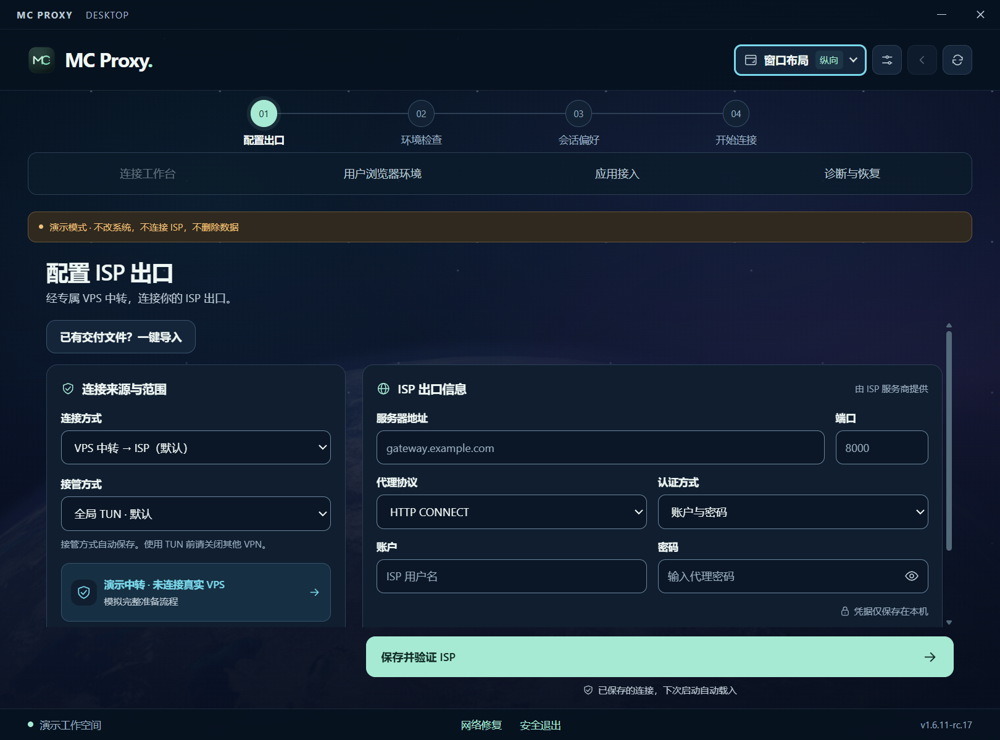

# MC Proxy

**面向 Claude 与海外网站合规访问的 Windows 工作台：核验 ISP 出口，保留独立浏览器会话，让日常工作环境更稳定、更一致。**

MC Proxy 以 **Claude 及其他海外服务的日常访问与工作**为主要使用场景。连接自备的 ISP 代理，选择适合当前网络的入口，核验实际出口，再打开保留登录的独立浏览器环境。线路、账号资料、环境配置和故障信息，都可以在同一个客户端里管理。

> **维护者实测反馈：** 已在 Claude 及部分海外网站中完成正常访问与使用验证，并在这些测试环境中较好应对了平台访问风控带来的干扰。这是维护者报告的实际使用结果，不代表所有网站、账号或后续平台策略下的效果保证。

当前源码版本 **1.6.11-rc.17** · Windows x64 · Electron · 原生 HTML/CSS/JavaScript

[English](README.md) · [功能指南](docs/FEATURES.md) · [开发与验证](docs/DEVELOPMENT.md) · [架构](docs/ARCHITECTURE.md) · [许可机制](docs/LICENSING.md) · [安全说明](SECURITY.md)



*界面演示使用示例信息，不含真实线路凭据。*

## 能做什么

| 能力 | 使用方式 |
| --- | --- |
| Claude 日常工作入口 | 将出口核验、独立浏览器会话、环境设置和故障诊断串成一条工作流程 |
| 核验并固定 ISP 出口 | 保存配置时通过两个独立来源检查出口；建立连接后继续核对预期 IP，出口不符时拒绝就绪 |
| 三种链路入口 | 自建 VPS 中转、导入本地 VPN 节点，或使用已经开启的外部 VPN |
| 系统与应用接入 | VPS / 导入节点支持全局 TUN、智能规则 TUN；显式代理适合主动接入的应用 |
| 保留登录的浏览器环境 | 默认使用本机 Google Chrome 的独立资料目录，支持 Edge 和可选指纹浏览器 |
| 多个用户浏览器环境 | 按用途保存不同 Cookie、网站存储与常用网站，绑定已核验的 ISP 配置 |
| 工作与日常环境 | 管理时区、语言与区域设置，保存原始快照，提供明确的恢复操作 |
| 连接诊断与恢复 | 区分代理出口、系统出口、目标 TLS 和浏览器观察结果，导出本地脱敏故障报告 |
| 双版交付机制 | Developer 提供维护与离线许可签发工具；Licensed 使用设备绑定的签名许可 |

### 三条入口，一条 ISP 出口

```text
Windows ─┬─ 自建 VPS 中转 ─────────┬─ 自备 ISP 代理 ─ 网站
         ├─ 导入的 VPN 节点 ───────┤
         └─ 已开启的外部 VPN ──────┘
```

- **VPS 中转**：使用私有注册信息连接自建中转，再通过 ISP 访问目标。
- **导入 VPN 节点**：由 MC Proxy 启动核心连接节点，无需另开 VPN 客户端。支持 Clash YAML、sing-box JSON、节点 URI、单层 Base64 文本及有限 INI / V2Ray 配置；协议覆盖 SS、VMess、VLESS、Trojan、Hysteria2、TUIC、HTTP 和 SOCKS。具体传输与字段受解析器支持范围约束。
- **外部 VPN 兼容**：沿用已开启的 VPN，通过可用系统路径或其本地 HTTP / SOCKS5 入口访问 ISP；该模式只提供显式 HTTP 代理，外部 VPN 需要持续运行。

ISP 入口支持 HTTP CONNECT 或 SOCKS5。软件不提供 ISP、VPN 订阅或 VPS 账号；出口是否长期固定取决于你的供应商，客户端负责检测与核对。

### Claude 访问与风控适配

项目重点减少出口 IP 变化、浏览器会话混用、本地环境不一致等因素带来的访问异常。通过预期出口核验、可复用的独立浏览器资料、可选环境设置与分层诊断，让这些因素保持一致。默认使用 Google Chrome，常规使用流程不依赖可选指纹浏览器。

请仅在具备使用权限和地区资格的前提下，遵守适用法律及目标服务条款。MC Proxy 是独立项目，并非 Anthropic 官方产品，也未获得 Claude 官方背书；软件不能改变账号资格，不承诺绕过全部风控、免验证或防封。具体配置和排障流程见[功能指南](docs/FEATURES.md)。

### 按需要选择接管范围

**全局 TUN** 接管系统路由与 DNS，**智能规则 TUN** 为本地私网访问保留例外，公共目标仍使用 ISP 链路。TUN 连接会分别检查本地代理与系统默认网络的 HTTPS 出口。**显式应用代理** 只覆盖主动配置代理的应用，独立浏览器会自动接入。

新配置默认选择全局接管；已有偏好会保留。真实 TUN 需要管理员权限，使用本项目 TUN 前应关闭可能冲突的外部 VPN。

### 让浏览器环境成为可重复使用的工作入口

默认 Chrome 空间与日常 Chrome 个人资料分开，正常结束连接后保留 Cookie、网站存储和书签。下次打开同一空间，可继续使用已有资料；网站仍可能因会话过期而要求重新登录。

多个账号或用途可以建立不同的用户浏览器环境。每个环境固定浏览器类型，绑定 ISP 配置，切换前先正常关闭当前受管浏览器；一次运行一个环境。资料刷新、归档与恢复提供独立操作，移除环境卡片不会删除浏览器资料。

指纹浏览器是可选组件，支持保存稳定身份并管理独立资料。使用它不代表网站无法识别，也不保证账号不受限制。

**公开源码包含指纹浏览器接入、身份与资料管理、原生 C++ 修改、补丁、构建和验收工具。** 不附带预编译 EXE、完整 Chromium 源码缓存或个人资料；各部分位置见 [指纹浏览器源码方案](docs/FINGERPRINT_BROWSER.md)。

## 从源码开始

在 Windows 上安装 Node.js **24 LTS** 和 pnpm，然后运行：

```powershell
git clone https://github.com/Karterlar/mc-proxy-isp.git
cd mc-proxy-isp
pnpm install --frozen-lockfile
pnpm run install:desktop
pnpm dev
```

`pnpm dev` 打开隔离的演示模式，可体验配置、连接状态、浏览器环境和诊断流程；网络、系统设置、清理与防火墙操作均为模拟，无需真实 ISP。

真实连接使用 `pnpm start`，还需要管理员权限、有效线路和固定版本的 sing-box 核心。完整打包还依赖匹配的源码构建指纹浏览器、完整性清单、构建收据与历史原生验收资源；公开源码不附带完整二进制和验收环境，克隆后不能直接完成整套发行构建。最小回归命令、完整测试前提与构建边界见[开发文档](docs/DEVELOPMENT.md)。

## 使用流程

1. 选择入口，导入节点或中转注册信息，填写 ISP 并核验出口。
2. 保存环境快照，选择接管范围与浏览器偏好。
3. 建立连接，等待代理出口和相应的系统出口检查完成。
4. 打开默认浏览器或命名环境开始工作；遇到问题可查看分层诊断并保存脱敏报告。
5. 结束连接后，按需要单独恢复系统环境。关闭窗口会收起到托盘，退出请使用安全退出入口。

## 当前边界

- 当前为 Windows x64 的未签名 RC 源码版本，实机升级、实际供应商线路与长期连接需要分别验收。
- 新断网锁的创建已暂停，仅保留旧锁识别与恢复。没有独立断网保护时，核心停止后普通应用可能恢复本机直连。
- TUN 阻止非 DNS UDP；依赖 UDP 的游戏、语音等应用可能无法使用。
- 系统出口检查覆盖新建请求；已有连接、独立代理设置与真实浏览器请求需要分别核验。配置 WebRTC / DNS 保护不等于每次会话已经通过泄漏检测。
- 导入配置只提取受支持的节点，不执行原配置中的规则、DNS 或代理组，也不自动更新订阅。
- 连通、延迟和出口一致性评分由本软件生成；网络可达不代表网站账号、地区资格、订阅或模型会话成功。

## 源码与许可

本仓库保留 `package.json` 中的 **UNLICENSED** 状态。公开展示源码不构成 MIT、GPL 或其他开源许可授权；使用、修改或再分发前需要获得权利人的明确许可。

第三方组件仍遵循各自许可证，相关材料见 [licenses](licenses)。本仓库不包含客户配置、浏览器资料、运行数据或许可签发私钥。

上传步骤见 [公开仓库准备](docs/PUBLISHING.md)。
