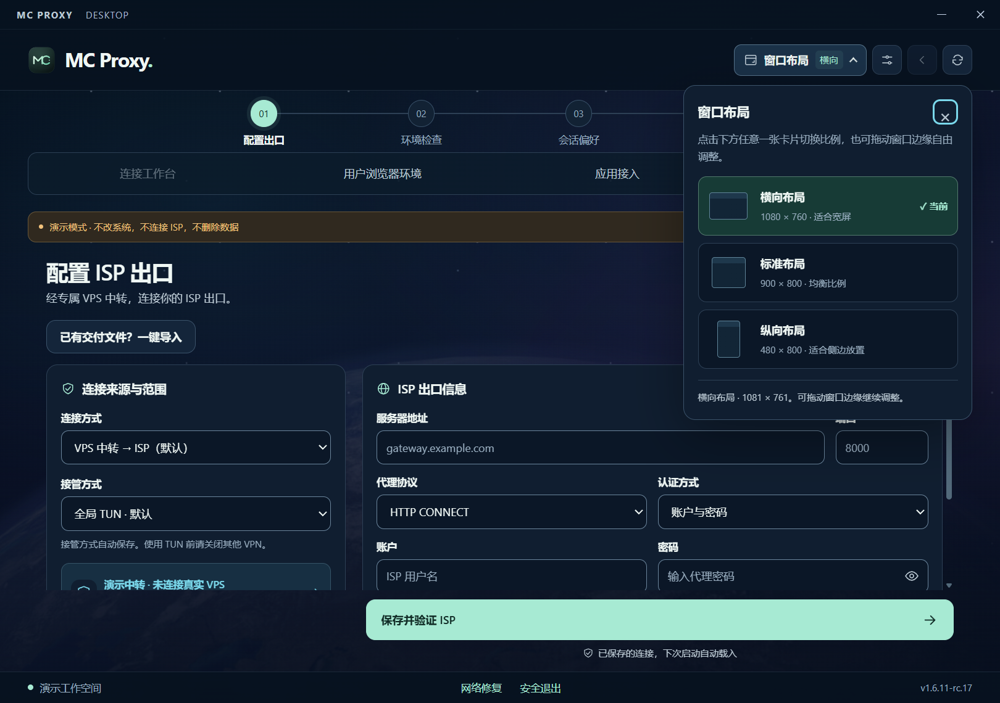

# From connection setup to a dedicated workspace

[English](FEATURES.md) | [简体中文](../FEATURES.md)

MC Proxy brings connection setup, ISP egress verification, browser profiles, and recovery tools into one workflow. Choose an entry point that works on your current network, connect it to your intended ISP exit, and reuse your browser sessions and work settings.

The application interface is currently in Chinese. This guide includes Chinese labels where they help you find a control or recognize a screenshot.

## Set up your first connection

1. **Choose an entry point** in the connection setup page (配置出口): use your own VPS, import a supported VPN node, or use an external VPN that is already running. MC Proxy does not include service accounts or network access.
2. **Enter your ISP proxy details**: provide the HTTP CONNECT or SOCKS5 host, port, and credentials supplied by your provider. Save and verify the ISP connection (保存并验证 ISP) to check the chain and the observed exit before saving. A failed check leaves the previous configuration in place.
3. **Prepare your environment**: save your everyday settings if needed, then choose a work environment and browser. Google Chrome is the default; its dedicated profile directory retains your logins.
4. **Connect from the workspace** (连接工作台): review the actual route, traffic scope, and verification results. For TUN connections, MC Proxy checks the local proxy and the system's default network exit separately, showing whether each check is ready, running, or failed.

TUN requires Windows administrator privileges. Close potentially conflicting external VPNs before using an imported node with MC Proxy's TUN. External VPN compatibility mode requires that VPN to remain running.

## Choose which traffic to route

| Mode | Intended use | Scope to keep in mind |
| --- | --- | --- |
| Global TUN | Route new system connections through the verified chain | A system check does not verify every application's own proxy settings or existing connections. |
| Smart rules TUN | Send public destinations through the ISP while retaining access to private networks | The routing policy in the source defines the specific exceptions. |
| Explicit application proxy | Connect a dedicated browser or a tool configured to use a proxy | Other applications are not automatically covered. |

The VPS and imported-node paths support TUN. External VPN compatibility mode provides an explicit HTTP proxy. Routing currently focuses on TCP; general forwarding of non-DNS UDP is not supported.

## Keep a browser environment for each purpose

Browser environments keep separate cookies, website storage, and frequently used destinations for personal work, projects, or different accounts. The default Chrome option uses a dedicated profile directory and leaves your everyday Chrome profile alone. You can also choose Edge or a compatible optional fingerprint browser runtime.

- Reusing an environment retains its data. Websites may still ask you to sign in again when their sessions expire.
- Each environment has a fixed browser type. Close the current managed browser normally before switching; one environment runs at a time.
- Refreshing profile data, restoring an archive, and removing an environment card are separate operations. Removing a card does not securely erase login data.
- Fingerprint options manage browser identity and profile data. They do not guarantee that websites cannot recognize you or restrict an account.

## Apply settings and recover deliberately

Work environments cover time zone, language, and regional settings, with country presets, saved custom settings, everyday-environment restoration, and an original snapshot. If some settings cannot be applied, successful changes remain in place and the unfinished items are listed. Language packs, system permissions, and application caches can affect the result.

Stopping the proxy, restoring system settings, and removing an old network lock are separate actions. Closing the main window minimizes the application to the tray and leaves background sessions running. Use **Safe exit** (安全退出) when you want to quit.

## Diagnose a problem

The workspace and diagnostics pages report proxy egress, system networking, destination TLS, browser observations, and application launch results separately. Errors appear on the page or in the drawer for the current operation. A successful HTTPS connection alone does not establish that a website account or model service is usable.

Fault reports are generated locally and export only a fixed set of redacted fields. Preview a report before sharing it. Checks for old network locks and the standalone network repair tools remain available, but **creation of new network locks is currently paused**. Do not rely on the application for continuous traffic blocking: ordinary applications may reconnect directly after the core stops.

See the [development guide](DEVELOPMENT.md) for demo mode and required resources, and the [security notes](../../SECURITY.en.md) for data and report boundaries.

## Fit the window to your desktop

Choose a landscape, standard, or portrait preset by clicking its card in **Window layout** (窗口布局), or resize the window by dragging its edges. Narrow windows retain the full workflow. The interface also accommodates keyboard focus, high contrast, and reduced motion.

